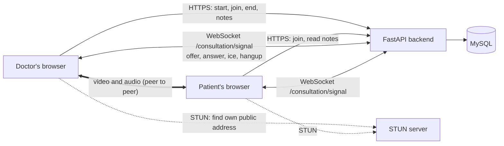
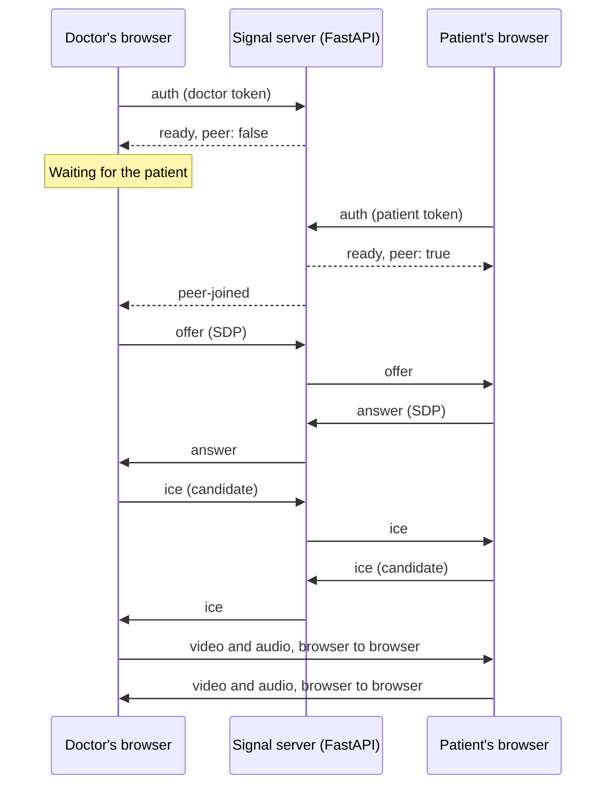
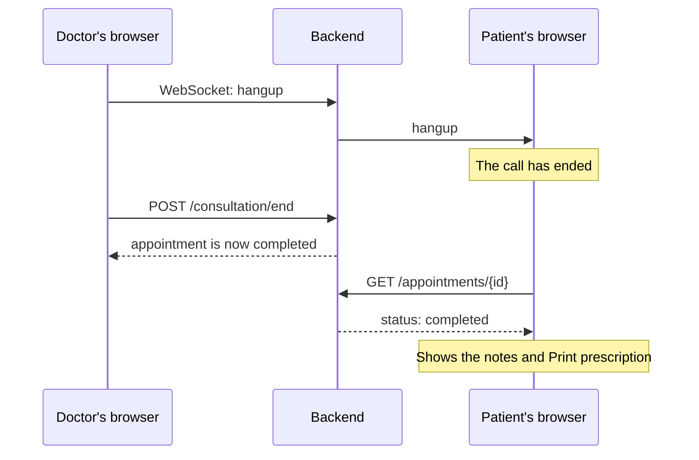

# AarogyaHub backend

FastAPI + MySQL. It has sign-up and login for patients and doctors, doctor profiles, and the admin routes for doctors and patients.

## Tables

| Table | What it holds |
|---|---|
| `users` | Every account: name, email, phone, city, password hash, role (patient, doctor or admin), blocked or not |
| `doctors` | A doctor's profile: speciality, licence number, council, experience, fee, qualifications, bio, and review status (pending, verified or rejected) with the rejection reason |
| `patients` | A patient's health details: date of birth, gender, blood group, allergies |
| `admins` | An admin's job title |
| `doctor_documents` | Licence, degree and ID files a doctor uploads for approval |
| `doctor_availability` | A doctor's weekly hours: day, start, end, slot length (5 to 30 minutes) |
| `appointments` | A booking: patient, doctor, start and end time (UTC), status, fee, reason |
| `consultations` | When a booked consultation started and ended |
| `consultation_reports` | The doctor's report: symptoms, diagnosis, other instructions, advice, follow-up date |
| `consultation_medicines` | The medicines in a report: name, dose, how often, days, notes, in order |
| `reports` | Files a patient uploads: PDFs, images and scans |
| `report_shares` | Which doctors a patient has shared each report with |
| `dicom_studies` | The scan inside a DICOM report: study UID, date, description, modality, body part, counts |
| `dicom_series` | Each series in a scan: series UID, number, modality, description, image count |
| `dicom_instances` | Each image in a series: SOP UID, number, size in pixels, and its name inside the zip |

## Routes

All routes start with `/api/v1`.

| Route | Who | What it does |
|---|---|---|
| `POST /auth/register` | anyone | Creates a patient account |
| `POST /auth/register/doctor` | anyone | Creates a doctor account and profile, waiting for review |
| `POST /auth/login` | anyone | Returns an access token and sets a refresh cookie |
| `POST /auth/refresh` | anyone with the cookie | Returns a new access token |
| `POST /auth/logout` | anyone | Clears the refresh cookie |
| `GET /users/me` | signed in | The signed-in user's account |
| `GET /patients/me` | patient | The patient's own account and health details |
| `PUT /patients/me` | patient | Updates name, phone, city and health details |
| `GET /doctors/me` | doctor | The doctor's own profile and review status. `NO_DOCTOR_PROFILE` if there isn't one yet |
| `PUT /doctors/me` | doctor | Creates or updates the profile. A new or rejected profile goes for review |
| `GET /doctors` | anyone | Approved doctors, by search and speciality |
| `GET /doctors/{id}` | anyone | One approved doctor |
| `GET /doctors/{id}/slots?date=` | anyone | Free slots on a day |
| `GET`, `POST /doctors/me/availability` | approved doctor | Weekly hours |
| `DELETE /doctors/me/availability/{id}` | approved doctor | Remove hours |
| `GET`, `POST /doctors/me/documents` | doctor | List or upload documents (PDF, JPG, PNG) |
| `GET /doctors/me/documents/{id}/file` | doctor | Open own document |
| `DELETE /doctors/me/documents/{id}` | doctor, not yet approved | Remove a document |
| `POST /appointments` | patient | Book a free slot |
| `GET /appointments/me` | patient or doctor | Own appointments (`status`, `upcoming` filters) |
| `GET /appointments/{id}` | its patient or doctor | One appointment |
| `POST /appointments/{id}/cancel` | its patient or doctor | Cancel before it starts |
| `POST /appointments/{id}/no-show` | its doctor | Mark a no-show after the start time |
| `POST /appointments/{id}/consultation/start` | its doctor | Start, from 10 minutes before until the end time |
| `POST /appointments/{id}/consultation/end` | its doctor | End; the appointment becomes completed |
| `POST /appointments/{id}/consultation/join` | its patient or doctor | Check the call is open and get the STUN/TURN servers. The patient gets `waiting: true` until the doctor starts |
| `WS /appointments/{id}/consultation/signal` | its patient or doctor | WebRTC signalling for the video call |
| `GET /appointments/{id}/consultation` | its patient or doctor | Start and end times |
| `PUT /appointments/{id}/consultation/report` | its doctor | Write or update the consultation report and its medicine list |
| `GET /appointments/{id}/consultation/report` | its patient or doctor | Read the report, with the doctor and patient details for printing |
| `POST /reports` | patient | Upload a report (PDF, JPG, PNG, DCM, ZIP) |
| `GET /reports/me` | patient | Own reports, with who they're shared with |
| `GET /reports/shared-with-me` | doctor | Reports patients shared with this doctor |
| `GET /reports/{id}/file` | owner, or a doctor it's shared with | Open the file |
| `DELETE /reports/{id}` | owner | Delete a report and its file |
| `POST /reports/{id}/shares` | owner | Share with an approved doctor |
| `DELETE /reports/{id}/shares/{doctor_id}` | owner | Stop sharing |
| `GET /reports/{id}/dicom` | owner, or a doctor it's shared with | The scan's study and series. `NOT_DICOM` if it isn't a scan |
| `GET /reports/{id}/dicom/series/{series_id}` | owner, or a doctor it's shared with | The images in a series, in order |
| `GET /reports/{id}/dicom/instances/{instance_id}/file` | owner, or a doctor it's shared with | Download one image (`.dcm`) |
| `GET /admin/doctors` | admin | Doctors, filtered by status and search |
| `GET /admin/doctors/{id}` | admin | One doctor |
| `POST /admin/doctors/{id}/verify` | admin | Approve, or reject with a reason |
| `GET /admin/doctors/{id}/documents` | admin | A doctor's uploaded documents |
| `GET /admin/doctors/{id}/documents/{doc_id}/file` | admin | Open a document while reviewing |
| `GET /admin/patients` | admin | Patients, filtered by search and status |
| `GET /admin/patients/{id}` | admin | One patient, with health details |
| `PATCH /admin/patients/{id}/block` | admin | Block (with a reason) or unblock |
| `GET /health` | anyone | Is the API up and can it reach MySQL |

## How doctor approval works

1. The doctor signs up in 4 steps on the website. Everything is sent once, to `/auth/register/doctor`.
2. The profile starts as `pending`. The doctor can log in, but sees "under review" instead of the doctor portal.
3. An admin opens Doctors in the admin console and approves the profile, or rejects it with a reason.
4. Approved: the doctor portal opens. Rejected: the doctor sees the reason, fixes the details and sends them again (`PUT /doctors/me`), which sets the status back to `pending`.
5. A profile can only be approved or rejected while it is `pending`.

## How booking works

1. An approved doctor adds weekly hours. Times are in Indian time (IST).
2. `GET /doctors/{id}/slots?date=` turns those hours into slots for that day, leaving out past and booked slots.
3. The patient books one of those exact slot times. Anything else gets `SLOT_NOT_AVAILABLE`.
4. Two people can't book the same slot: `appointments.active_slot` holds the start time while the booking is active, and a unique key on (doctor, active_slot) blocks a second booking. Cancelling clears it, so the slot opens again.
5. The doctor starts the consultation from 10 minutes before the slot, ends it, and writes the consultation report: notes, a list of medicines, advice and a follow-up date. Saving again replaces the medicine list.
6. The patient reads the report and can print the prescription. It shows the doctor's registration number and the patient's age, gender and allergies.

## How video consultations work

Video uses WebRTC. The camera and microphone go **straight between the two browsers**. The backend never sees the video; it only checks who may join and passes short setup messages between the doctor and the patient over a WebSocket. There is no video service to sign up for.

### The big picture



| Path | What travels on it |
|---|---|
| HTTPS to the API | Appointment status, start and end, the notes and prescription |
| WebSocket to the API | Small JSON setup messages only (`offer`, `answer`, `ice`, `hangup`) |
| Browser to browser | The live video and audio, encrypted by WebRTC |
| STUN server | Each browser asks "what is my public address?" so the other side can reach it |

### Step by step

**1. Opening the call page**

From 10 minutes before the booked time, the appointments page shows **Open consultation** (doctor) or **Join call** (patient). Both go to `/doctor/consultation/:id` or `/patient/consultation/:id`, which loads `GET /appointments/{id}` and checks the status again every 10 seconds.

**2. The patient waits**

The patient's page calls `POST /appointments/{id}/consultation/join` every 5 seconds:

```json
{ "status": "scheduled", "waiting": true, "ice_servers": [] }
```

While `waiting` is `true`, the patient sees a waiting room with their camera preview.

**3. The doctor starts**

The doctor presses **Start consultation**, which calls `POST /consultation/start`. The appointment becomes `in_progress`. Now `/join` answers both of them with the servers to use:

```json
{
  "status": "in_progress",
  "waiting": false,
  "ice_servers": [{ "urls": "stun:stun.l.google.com:19302" }]
}
```

`/join` only works for that appointment's patient and doctor, from 10 minutes before the start until 15 minutes after the end (`OUTSIDE_JOIN_WINDOW`). It refuses finished calls (`CALL_CLOSED`), and tells the doctor to start first (`NOT_STARTED`).

**4. Each browser connects**

Once `waiting` is `false`, each browser:

1. asks for the camera and microphone (`getUserMedia`);
2. opens `ws://<site>/api/v1/appointments/{id}/consultation/signal`;
3. sends its login token as the first message, within 10 seconds:

```json
{ "type": "auth", "token": "<access token>" }
```

The server checks the token and the appointment. If something is wrong it closes the socket with a code:

| Code | Meaning | What the page shows |
|---|---|---|
| 4401 | Not logged in, or the token is wrong or missing | "Log in again to join the call." with **Rejoin** |
| 4404 | Not this appointment's patient or doctor | "We could not find that appointment." |
| 4409 | The consultation isn't in progress (not started, ended, or more than 15 minutes past the end) | "The call has ended." |
| 4000 | The same person opened the call in another tab; the older tab is closed | "You joined the call in another tab." |

If the check passes, the server puts the socket in that appointment's room (one doctor and one patient) and replies:

```json
{ "type": "ready", "peer": false }
```

`peer` says whether the other person is already in the room.

**5. Setting up the connection (signalling)**

Whoever was in the room first makes the offer. The server only forwards messages; it never reads the video settings inside them.



- **SDP** (in `offer` and `answer`) describes the media: which camera and microphone formats each side can use.
- **ICE candidates** (in `ice`) are possible network addresses for reaching each browser. The browsers try them until one works.
- Each browser handles the messages one at a time, in the order they arrive, so a candidate is never applied before its offer.

**6. During the call**

- The other person shows large, your own camera small in the corner.
- **Mute microphone** and **Turn camera off** switch your own tracks off; nothing goes to the server.
- The doctor writes the notes and prescription next to the video. Saving calls `PUT /consultation/report` over normal HTTPS.
- The doctor can open the reports the patient shared (`GET /reports/shared-with-me`, `GET /reports/{id}/file`).

**7. Someone leaves or the connection drops**

- If the patient presses **Leave call** or closes the tab, their socket closes. The doctor gets `peer-left` and sees "Waiting for …" again. When the patient comes back, the server sends `peer-joined` and step 5 runs again.
- If the connection fails, the page shows the reason and a **Rejoin** button, which repeats steps 4 and 5.

**8. Ending the call**



The doctor presses **End consultation**. The doctor's browser sends `hangup`, closes its camera and socket, and calls `POST /consultation/end`. The patient's browser gets `hangup`, stops its camera, reloads the appointment and shows the notes, the medicines and **Print prescription**.

### Messages

| Message | Sent by | Passed on to | Meaning |
|---|---|---|---|
| `auth` | browser | (checked, not passed on) | First message, carries the login token |
| `ready` | server | the one who joined | You're in; `peer` says if the other person is there |
| `peer-joined` | server | the one already waiting | The other person arrived; send an offer |
| `peer-left` | server | the one still there | The other person left; wait again |
| `offer` | first in the room | the other person | Video settings (SDP) to start the connection |
| `answer` | second in the room | the other person | Reply to the offer (SDP) |
| `ice` | both | the other person | A possible network address (ICE candidate) |
| `hangup` | doctor | the patient | The call is over |

Any other message type is ignored.

### What the call screen shows

| State | Shown |
|---|---|
| `starting` | "Starting your camera…" |
| `waiting` | "Waiting for … to join the call…" |
| `connecting` | "Connecting to …" |
| `connected` | The other person's video |
| `ended` | "The call has ended." |
| `failed` | The reason, and a **Rejoin** button |

### Files

| File | Job |
|---|---|
| `backend/app/api/v1/consultations.py` | `/start`, `/join`, `/end`, the notes routes, and the `/signal` WebSocket |
| `backend/app/services/calls.py` | Who may join, the rooms in memory, passing messages on, the STUN/TURN list |
| `frontend/src/features/consultation/ConsultationPage.tsx` | The call page: header, video area, notes panel, start and end buttons |
| `frontend/src/features/consultation/useCall.ts` | Calls `/join`, every 5 seconds while the patient waits |
| `frontend/src/features/consultation/usePeerCall.ts` | Camera and microphone, the WebSocket, and the WebRTC connection |
| `frontend/src/features/consultation/VideoRoom.tsx` | The video tiles, mute and camera buttons, waiting screens |
| `frontend/src/features/consultation/NotesPanel.tsx` | The doctor's notes form and shared reports; the patient's notes after the call |
| `frontend/vite.config.ts` | `ws: true` so the dev server passes WebSockets to the backend |

### Things to know

- Browsers only allow the camera on `localhost` or `https://`. To test with a second device, serve the site over HTTPS.
- `STUN_URLS` in `.env` sets the STUN servers (Google's free one by default). On some mobile, office or hospital networks the browsers can't connect directly. For those, add a TURN relay server with `TURN_URL`, `TURN_USERNAME` and `TURN_PASSWORD` (for example a coturn server you run). With TURN, the video passes through that relay instead of going directly.
- Who is in which call is kept in the server's memory, so run the backend as one process (the normal `uvicorn` command). Restarting the backend drops live calls; both sides can press **Rejoin**.
- Calls are not recorded, and the video is never stored.

## How scans work

1. A patient uploads a `.dcm` file, or a `.zip` of `.dcm` files, as a report.
2. The backend reads the DICOM headers with pydicom (not the pixels) and saves one row in `dicom_studies`, one per series in `dicom_series`, and one per image in `dicom_instances`. Files in the zip that aren't DICOM are skipped.
3. A file with no DICOM images gets `INVALID_DICOM`, and a zip with images from more than one study gets `MULTIPLE_STUDIES`. Nothing is saved in either case.
4. The zip isn't unpacked. Downloading an image reads it straight from the stored zip.
5. Deleting the report deletes its scan rows too.

## Uploaded files

Files are saved under `backend/uploads/` (set `UPLOAD_DIR` in `.env` to change it), up to `MAX_UPLOAD_MB` (20 MB). The folder isn't in git. Only the owner, a doctor a report is shared with, or an admin reviewing a doctor can open a file.

## How login works

1. **Register:** the password is hashed with argon2 and saved in `users.password_hash`. The plain password is never stored.
2. **Log in:** the backend checks the password and sends back two tokens:
   - an **access token** (lasts 15 minutes). The frontend keeps it in memory and sends it as `Authorization: Bearer <token>`.
   - a **refresh token** (lasts 7 days) in an HttpOnly cookie, which page scripts can't read.
3. **Page reload:** the frontend calls `/auth/refresh`. The browser sends the cookie, and the backend returns a new access token.
4. **Protected routes:** `get_current_user` reads the access token. `require_admin` and `require_doctor` allow only that role.
5. **Log out:** the cookie is cleared.
6. **Blocked users** can't log in or refresh.

## Files

```
backend/
  app/
    main.py                  app, CORS, error format, routes
    core/
      config.py              settings from .env
      security.py            password hashing, tokens
      deps.py                get_db, get_current_user, role checks, current_doctor, verified_doctor
      storage.py             save, send and delete uploaded files
      errors.py              AppError -> { "error": { "code", "message" } }
    db/
      base.py                SQLAlchemy base class
      session.py             MySQL connection
      pagination.py          page through a query
    models/
      user.py                users table
      doctor.py              doctors table
      patient.py             patients table
      document.py            doctor_documents table
      availability.py        doctor_availability table
      appointment.py         appointments table
      consultation.py        consultations, consultation_reports and consultation_medicines tables
      report.py              reports and report_shares tables
      dicom.py               dicom_studies, dicom_series and dicom_instances tables
      admin.py               admins table
    schemas/
      auth.py                register, login, token shapes
      doctor.py              doctor sign-up, profile, review shapes
      patient.py             patient profile shapes
      document.py, availability.py, appointment.py, consultation.py, report.py, dicom.py
      user.py                user shapes
      common.py              Page, date and blank-field helpers
    api/
      v1/
        router.py            collects every route file
        auth.py              register (patient and doctor), login, refresh, logout
        me.py                GET /users/me
        doctors.py           GET and PUT /doctors/me
        patients.py          GET and PUT /patients/me
        documents.py         doctor documents
        availability.py      doctor weekly hours
        appointments.py      book, list, cancel, no-show
        consultations.py     start, end, consultation report
        reports.py           patient reports and sharing
        dicom.py             scan study, series and image download
        admin/
          doctors.py         list, detail, approve or reject
          patients.py        list, detail, block or unblock
    services/
      slots.py               turns weekly hours into free slots (IST)
      appointments.py        shared lookups for doctors and appointments
      reports.py             who can see a report
      dicom.py               reads DICOM headers from a .dcm or .zip
      calls.py               who may join a call, and passing WebRTC messages between the two browsers
  scripts/
    seed_users.py            creates the tables, sample users, and any missing doctor, patient and admin profiles
    create_admin.py          creates your admin account, or resets its password
  tests/
    conftest.py
    integration/             one test file per area
  pyproject.toml
  .env.example
```

## Setup

Run these from the `backend` folder.

1. Create the database on your MySQL server:

   ```sql
   CREATE DATABASE aarogyahub CHARACTER SET utf8mb4 COLLATE utf8mb4_0900_ai_ci;
   ```

2. Copy `.env.example` to `.env` and fill in:
   - `DATABASE_URL`: your MySQL details
   - `STUN_URLS`, `TURN_URL`, `TURN_USERNAME`, `TURN_PASSWORD`: optional, for video calls (see "How video consultations work")
   - `JWT_SECRET`: a long random string. Make one with:

     ```bash
     python -c "import secrets; print(secrets.token_urlsafe(48))"
     ```

3. Install, then create the tables, the sample users and your admin:

   ```bash
   python -m venv .venv
   .venv/Scripts/python -m pip install -e ".[dev]"
   .venv/Scripts/python -m scripts.seed_users
   .venv/Scripts/python -m scripts.create_admin
   ```

   `create_admin` asks for an email and a password. The sample users have no password, so they can't log in. Register new accounts on the frontend's `/register` page.

## Run

```bash
.venv/Scripts/python -m uvicorn app.main:app --reload --port 8000
```

API docs: http://localhost:8000/docs

Restart the server after you change `.env`.

## Tests

```bash
.venv/Scripts/python -m pytest
```

## Postman

`postman/` at the repo root has a small collection with one request for each basic create, read, update and delete action (36 requests):

| Folder | Requests |
|---|---|
| 1. Auth | register a patient and a doctor, log in as admin, doctor and patient, my account |
| 2. Admin | list and get doctors, approve the doctor, list and get patients, block, unblock |
| 3. Profiles | get and update the patient and doctor profiles |
| 4. Doctor availability | add and list weekly hours |
| 5. Appointments | list doctors, free slots, book, list, get, cancel |
| 6. Reports | upload, list, share, list shared, stop sharing, delete |
| 7. Doctor documents | upload, list, admin lists |
| 8. Clean up | delete the hours, log out |

Each request checks the status code and saves the IDs the next requests need. The first request makes a fresh patient and doctor, so the collection can be run again.

1. In Postman: **Import** → pick both files in `postman/`.
2. Choose the **AarogyaHub local** environment, and set `adminEmail` and `adminPassword` to the admin you created.
3. Set Postman's working directory to the repo root (Settings → General → Working directory), so the uploads find `postman/files/`.
4. With the server running, open the collection → **Run**, folders in order.
