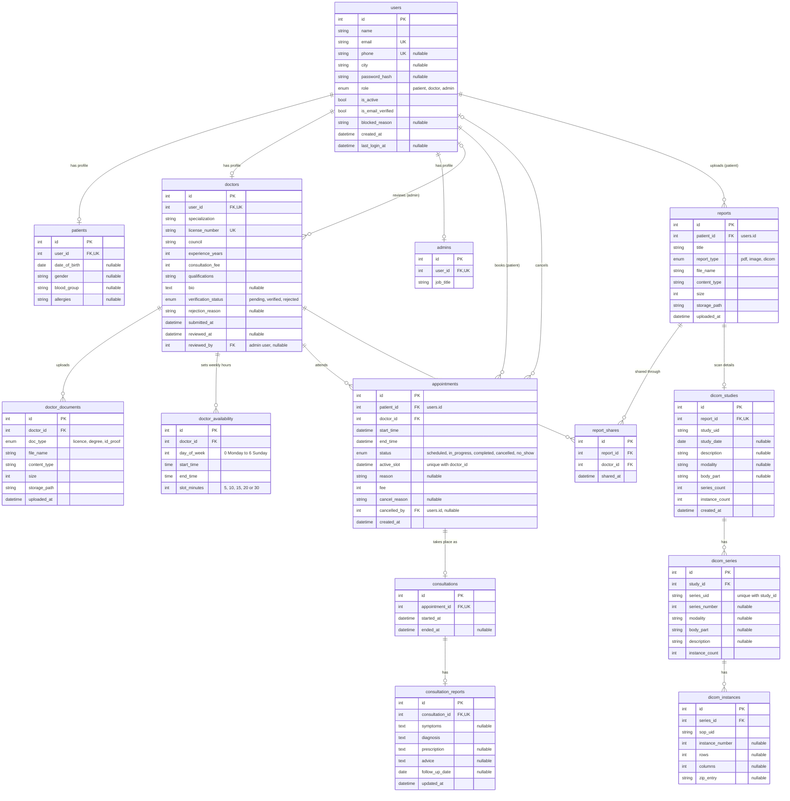

# AarogyaHub database diagram

All 15 tables and how they connect. GitHub and VS Code (with a Mermaid extension) draw this as a picture.

## Relationships

| From | To | Kind | Through |
|---|---|---|---|
| users | patients | one to zero-or-one | `patients.user_id` (unique) |
| users | doctors | one to zero-or-one | `doctors.user_id` (unique) |
| users | admins | one to zero-or-one | `admins.user_id` (unique) |
| users (admin) | doctors | one to many | `doctors.reviewed_by` |
| doctors | doctor_documents | one to many | `doctor_documents.doctor_id` |
| doctors | doctor_availability | one to many | `doctor_availability.doctor_id` |
| users (patient) | appointments | one to many | `appointments.patient_id` |
| doctors | appointments | one to many | `appointments.doctor_id` |
| users | appointments | one to many | `appointments.cancelled_by` |
| appointments | consultations | one to zero-or-one | `consultations.appointment_id` (unique) |
| consultations | consultation_reports | one to zero-or-one | `consultation_reports.consultation_id` (unique) |
| users (patient) | reports | one to many | `reports.patient_id` |
| reports | report_shares | one to many | `report_shares.report_id` |
| doctors | report_shares | one to many | `report_shares.doctor_id` |
| reports | dicom_studies | one to zero-or-one | `dicom_studies.report_id` (unique) |
| dicom_studies | dicom_series | one to many | `dicom_series.study_id` |
| dicom_series | dicom_instances | one to many | `dicom_instances.series_id` |

`report_shares` links `reports` and `doctors` many to many: one report can be shared with many doctors, and a doctor can see reports from many patients.

## Rules the database enforces

- One profile per account: `user_id` is unique in `patients`, `doctors` and `admins`.
- `users.email`, `users.phone` and `doctors.license_number` are unique.
- No double booking: (`doctor_id`, `active_slot`) is unique in `appointments`. `active_slot` holds the start time while the booking is scheduled or in progress, and is empty otherwise, so a cancelled slot can be booked again.
- A report is shared with a doctor at most once: (`report_id`, `doctor_id`) is unique in `report_shares`.
- One consultation per appointment, and one report per consultation.
- One scan per DICOM report: `report_id` is unique in `dicom_studies`, and a series appears once per study: (`study_id`, `series_uid`) is unique in `dicom_series`. Deleting a report deletes its study, series and images.
